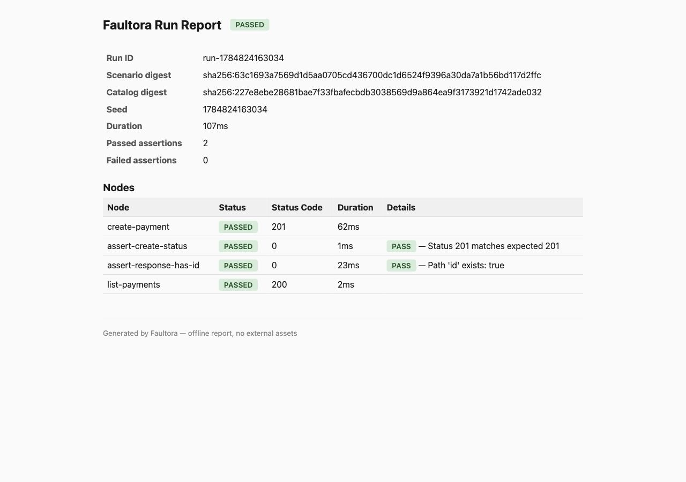

# Faultora

**Break it here. Trust it everywhere.**

Services that pass their functional tests still break business promises when
requests overlap, clients retry, or a dependency misbehaves: a payment taken
twice, the last seat sold twice, half of an operation left behind. Each
response looks fine; the damage shows only across steps and components.

Faultora is a self-hosted reliability testing CLI that checks those promises
from the outside. It imports OpenAPI and AsyncAPI descriptions, runs repeatable
scenarios with real concurrency and bounded faults across HTTP, Kafka and
read-only database queries, asserts business invariants rather than only
status codes, and produces console, JSON, HTML, and JUnit reports. Execution
stays inside your infrastructure and does not require a hosted control plane
or telemetry.

It is meant for teams responsible for services where a duplicate or a lost
update is costly, including teams in closed environments that cannot send
descriptions or traffic to a hosted product. It is not a load-testing,
infrastructure-chaos, or production-experiment tool.
[Why Faultora exists](docs/WHY.md) explains the problem, the design decisions,
when to use something else, and what is not yet proven. To ask a question,
report a problem or contribute, see
[support](https://github.com/Malatiel/Faultora/blob/main/SUPPORT.md) and
[contributing](https://github.com/Malatiel/Faultora/blob/main/CONTRIBUTING.md).

The scenario format is frozen at `faultora.dev/v1`; the application version
below moves independently of it.

Version 0.13.0 is a runnable technical preview. It targets local development
and CI use on Java 21, and it can now run **inside a private network** as a
runner that dials out for work.

## First ten minutes

You need Java 21, the OpenAPI description of a service, and the address of a
test environment where it runs. Nothing is sent anywhere else.

**1. Install.** Download `faultora-0.13.0.tar.gz` (or `.zip`) and `SHA256SUMS`
from the [release](https://github.com/Malatiel/Faultora/releases/tag/v0.13.0),
check them as [Installing the CLI](docs/INSTALLATION.md) shows, including who
built them, extract the archive where you keep tools, and put its `bin` on
your `PATH`:

```bash
mkdir -p ~/tools && tar xzf faultora-0.13.0.tar.gz -C ~/tools
export PATH="$HOME/tools/faultora-0.13.0/bin:$PATH"
faultora --version
```

On Windows, extract the `.zip` with `Expand-Archive`, add its `bin` to `PATH`
(`$env:Path = "C:\tools\faultora-0.13.0\bin;$env:Path"`) and the command is
the same; in PowerShell, join the continued lines below or end them with a
backtick instead of `\`. Keep your scenarios and results in your own project,
not in the installation, which an upgrade replaces.

**2. Generate a starter scenario** from your description, in your project:

```bash
faultora init --from-openapi openapi.yaml --output my-checks
```

`init` writes `my-checks/scenario.yaml` with a step for every operation that
can run with nothing filled in, lists the others as comments saying what they
need, and prints the next commands.

**3. Check it without contacting anything:**

```bash
faultora validate --scenario my-checks/scenario.yaml --openapi openapi.yaml
faultora test --preview --scenario my-checks/scenario.yaml \
  --openapi openapi.yaml --target https://staging.example.com
```

`validate` checks the documents; the preview compiles the plan against the
execution policy and prints it as JSON, without a single request.

**4. Run it:**

```bash
faultora test --scenario my-checks/scenario.yaml --openapi openapi.yaml \
  --target https://staging.example.com --format console,html --output results
```

Exit code 0 means every assertion passed, 1 that the run found a failure, 2
that the configuration was refused before anything ran, and 3 that the command
itself could not do its job — for example because `results/` already holds an
earlier run; give each run a new `--output` directory. The console shows each
node; the output directory holds the HTML report and the journal. A service on
localhost or another private address also needs `--allow-private`, and a step
that deletes something needs `--allow-destructive`;
[troubleshooting](docs/TROUBLESHOOTING.md) explains each refusal.

**5. Check a promise, not just a response.** The starter only shows that
operations answer. What Faultora is for is a business rule under the
conditions that break it — for example, that two clients sending the same
request at once create one thing, not two:

```yaml
execute:
  - id: race
    type: parallel
    steps:
      - id: first-client
        operationId: create-order          # your create operation
        inputs: {headers: {Idempotency-Key: same-key}, body: {item: book}}
      - id: second-client
        operationId: create-order
        inputs: {headers: {Idempotency-Key: same-key}, body: {item: book}}
  - id: read-back
    operationId: list-orders               # an operation that shows the result
    dependsOn: [race]

assertions:
  - id: exactly-one-order
    assertionType: jsonpath
    targetStep: read-back
    params: {path: "@", count: 1}
```

Counting the whole list holds only where it starts empty; on a shared
environment, read back what this run created — by the ID a client got back,
or a list filtered by a value only this run used.
[`fault-concurrent-duplicate.yaml`](examples/payment-service/scenarios/fault-concurrent-duplicate.yaml)
is the complete version of this check, with injected latency widening the
race; the [examples guide](examples/README.md) shows retries, eventual
consistency, events and faults the same way, and the
[scenario reference](docs/SCENARIO_REFERENCE.md) lists every field.

**Or let an AI assistant do it.** Faultora's MCP server lets an assistant
inspect your description, write and prepare scenarios, and run them once you
sign an approval; [using Faultora with an AI assistant](docs/AI_ASSISTANTS.md)
shows how to connect one.

## What 0.13.0 includes

In short: OpenAPI, AsyncAPI and read-only database catalogs; HTTP and Kafka
operations; sequential, parallel, repeat and eventually blocks with retries
and deadlines; in-process and Toxiproxy faults with bounded rollback;
contract, schema, event and tabular assertions whose parameters compare one
step's result with another's; console, JSON, HTML and JUnit reports; a
diagnostic bundle for bug reports; an MCP server for AI assistants; and a
runner for private networks. [What Faultora includes](docs/FEATURES.md) lists
all of it, with its limits.

## Requirements

- Java 21 or newer;
- Maven is not required when using the release JAR.

## Install

### CLI archive

The build produces `faultora-VERSION.zip` and `faultora-VERSION.tar.gz`, each
with Windows and Linux launchers, the executable JAR, licenses, documentation
and YAML examples. Extract an archive, keep its directories together, and run
`bin/faultora` on Linux or `bin\faultora.cmd` on Windows. Java is selected from
`JAVA_HOME`, or from `PATH` when `JAVA_HOME` is unset; no runtime is installed.

See [Installing the CLI](docs/INSTALLATION.md) for checksums, commands for both
platforms, and the archive layout. Releases from 0.11.2 publish both archives
beside the standalone JAR; to build them from a checkout, run
`./mvnw package -DskipTests` (`.\mvnw.cmd package -DskipTests` on Windows) and
find them under `faultora-cli/target/`.

### Standalone JAR

Download the release JAR and its checksums:

```bash
FAULTORA_VERSION=0.13.0
RELEASE_URL="https://github.com/Malatiel/Faultora/releases/download/v${FAULTORA_VERSION}"

curl --fail --location --retry 3 \
  --output "faultora-${FAULTORA_VERSION}.jar" \
  "${RELEASE_URL}/faultora-${FAULTORA_VERSION}.jar"
curl --fail --location --retry 3 \
  --output SHA256SUMS \
  "${RELEASE_URL}/SHA256SUMS"

grep " faultora-${FAULTORA_VERSION}.jar$" SHA256SUMS \
  | sha256sum --check --strict -

java -jar "faultora-${FAULTORA_VERSION}.jar" --version
```

On macOS, use `shasum -a 256 -c` instead of `sha256sum --check --strict`.
Every release also includes a CycloneDX SBOM and the Apache 2.0 license.

## Build from source

[Contributing](https://github.com/Malatiel/Faultora/blob/main/CONTRIBUTING.md)
covers setting up a checkout and the focused tests to run while changing it.
The whole build is:

```bash
./mvnw verify -B
```

For the required Linux release checks, use the
[strict qualification profile and report gate](docs/QUALIFICATION.md).
The default local build can skip Docker and socket-inspection tests when
their prerequisites are unavailable; those skips do not prove qualification.

The executable artifact is written to:

```text
faultora-cli/target/faultora-0.13.0.jar
```

The regular CI build can run without repository secrets. Configure the
`NVD_API_KEY` repository secret to enable OWASP Dependency Check on every push.
Release publication always requires this secret and fails closed when it is
missing.

## Running the bundled examples

The commands in this and the following sections use `faultora` on your `PATH`,
as in the first ten minutes; from a source checkout, use
`java -jar faultora-cli/target/faultora-0.13.0.jar` instead. Paths such as
`examples/payment-service/...` are relative to the extracted archive or the
repository root. The archive carries the example descriptions and scenarios,
so `validate` and `test --preview` work from it as shown; the example
services a real run talks to are started from a source checkout, as the
[examples guide](examples/README.md) explains.

Check the executable and validate the example scenario:

```bash
faultora --version

faultora \
  validate \
  --scenario examples/payment-service/scenarios/passing.yaml
```

Generate a starter scenario from an OpenAPI document:

```bash
faultora \
  init \
  --from-openapi examples/payment-service/openapi.yaml \
  --output ./generated
```

Run a scenario against an API:

```bash
faultora \
  test \
  --scenario examples/payment-service/scenarios/passing.yaml \
  --openapi examples/payment-service/openapi.yaml \
  --target https://api.example.com \
  --format console,json,junit,html \
  --output faultora-results
```

Private, loopback, and link-local destinations are blocked by default. Use
`--allow-private` only for an explicitly trusted local test environment.
Operations the description classifies as destructive are withheld in the same
way: a cleanup that deletes what its setup created is ordinary and supported,
but it takes `--allow-destructive` to permit it.

The [examples guide](examples/README.md) walks through contract, retry,
eventual, cross-component and fault lifecycle scenarios, including their
required observations and the limits of each passing result.

### Plan preview

For scripts, put `--diagnostics=json` before the command to receive one versioned
JSON diagnostic result on stdout. It includes stable codes, node/document
locations, hints and the existing exit code; technical logs remain on stderr.
With `test --preview`, the preview is nested in the same result. See the
[machine diagnostic contract](docs/CLI_DIAGNOSTICS.md) for fields and limits.

Add `--preview` to `test` to inspect the compiled plan without running it:

```bash
faultora \
  test --preview \
  --scenario examples/payment-service/scenarios/passing.yaml \
  --openapi examples/payment-service/openapi.yaml
```

The JSON on stdout contains catalog target/operation identities, admitted
capability types, actions, fault types/durations, request/concurrency/time/payload
budgets and located scenario/compiler refusals. Group children include retry
attempts and repeat/poll multipliers. It omits endpoint URLs, request values,
credentials and fault parameters. No target or fault management requests are
sent, and existing journals and reports are untouched. A compiled plan returns
exit 0; a scenario/compiler refusal returns exit 2. Option, file, catalog-import
and input-binding errors keep the ordinary CLI error handling.

`compiled: true` describes static compilation. Credentials, reachability and
provider-specific runtime parameters are checked during execution. A preview
does not authorize or reserve a later run. Explicitly admitted plugins execute
in-process and remain subject to the limitations in [ADR-027](docs/adr/ADR-027-run-preparation.md).

### Targets

Target identity — name, protocols, authentication schemes — comes from the
imported description. `--target` decides where that target actually lives for
this run:

```bash
# every catalog target that speaks this URL's protocol answers here
--target https://staging.example.com

# one catalog target is bound separately, the rest follow the plain --target
--target https://staging.example.com --target ledger=http://localhost:7777

# a run spanning two protocols binds each of them
--target https://staging.example.com --target broker=kafka://localhost:9092
```

A plain `--target` rebinds only the targets whose protocol its scheme names, so
an HTTP URL cannot silently redirect a broker. Naming a target explicitly
redirects it whatever it speaks.

An operation whose target is neither declared in the catalog nor bound to a
URL fails with `TARGET_NOT_FOUND` instead of being sent somewhere arbitrary.

The base URL inside an OpenAPI document is never contacted on its own: without
`--target`, every target is bound to `http://localhost:8080`. A description
committed to a repository cannot direct a run at the environment it
documents.

## Fault injection

The flagship reliability scenario races two concurrent `create-payment`
requests that share one `Idempotency-Key` while injected latency widens the
race window, then asserts the business invariant that exactly one payment
exists:

```bash
faultora \
  test \
  --scenario examples/payment-service/scenarios/fault-concurrent-duplicate.yaml \
  --openapi examples/payment-service/openapi.yaml \
  --target http://localhost:8080 \
  --allow-private
```

```text
--- Nodes ---
  [PASSED] sync-delay (0ms)
  [PASSED] first-client (164ms)
  [PASSED] second-client (166ms)
  [PASSED] race (167ms)
  [PASSED] list-payments (164ms)
  [PASSED] first-client-got-a-payment (0ms)
         Assertion: PASS — Assertion passed
  [PASSED] second-client-got-a-payment (0ms)
         Assertion: PASS — Assertion passed
  [PASSED] exactly-one-payment (0ms)
         Assertion: PASS — Assertion passed

--- Faults ---
  [http-latency] target * — active 10003ms, rollback: run-end
         During fault: first-client, second-client, list-payments
```

An assertion's verdict line is fixed text. Reports, journals and diagnostics
carry its outcome, not the values it compared — those can quote what the
target returned — and not the `message` written in the scenario; the node ID
says which assertion it was, and the scenario says what it checks.

The same scenario detects the classic check-then-act idempotency bug: the
end-to-end suite runs it against a deliberately broken variant of the example
API and requires the invariant assertion to fail.

Further reference scenarios cover a lost response followed by an
idempotency-key retry (`fault-duplicate-payment.yaml`), retrying through a
brief outage (`fault-retry.yaml`), and SLA verification under injected
latency (`fault-latency.yaml`). See the
[scenario reference](docs/SCENARIO_REFERENCE.md#faults) for fault types,
parameters, and rollback guarantees.

## Eventual consistency and batches

An `eventually` block polls one operation until every condition holds, so a
scenario can verify asynchronous state without sleeping for a guessed
duration:

```yaml
- id: settlement-visible
  type: eventually
  timeout: 10s
  interval: 200ms
  dependsOn: [create-payment]
  steps:
    - id: poll-payment
      type: operation
      operationId: get-payment
      inputs:
        paymentId: "{{steps.created.body.id}}"
  until:
    - assertionType: jsonpath
      params:
        path: status
        equals: settled
```

```text
--- Nodes ---
  [PASSED] create-payment (47ms)
  [PASSED] poll-payment (444ms)
  [PASSED] settlement-visible (444ms) — 3 polls
         Assertion: PASS — Assertion passed
         Assertion: PASS — Assertion passed
```

When the conditions never hold, the block fails with the budget it spent and
the last observed value rather than hanging:

```text
  [FAILED] never-refunded (611ms) — 7 polls
         Error: Conditions were not satisfied within 600ms after 7 polls:
                Path 'status' expected 'refunded' but got 'settled'
```

A `repeat` block runs its children once per iteration, over a fixed count or a
literal item list:

```yaml
- id: create-batch
  type: repeat
  forEach: [EUR, USD, GBP]
  steps:
    - id: create-payment
      type: operation
      operationId: create-payment
      inputs:
        body:
          currency: "{{repeat.item}}"
```

Both blocks are budgeted before execution: the poll count and the iteration
count are known at compile time and count against the run's request budget.
Reference scenarios live in
[`examples/payment-service/scenarios`](examples/payment-service/scenarios)
as `eventually-settlement.yaml` and `repeat-batch.yaml`.

## Events

An AsyncAPI 3.0 description brings Kafka channels into the same catalog as the
HTTP operations, and `--openapi` and `--asyncapi` can be given together:

```bash
faultora \
  test \
  --scenario examples/payment-worker/scenarios/duplicate-delivery.yaml \
  --asyncapi examples/payment-worker/asyncapi.yaml \
  --target broker=kafka://localhost:9092 \
  --allow-private
```

An event operation is an ordinary `operation` step; there is no separate step
type, so retries, deadlines, `eventually`, and generated payloads all work on
it unchanged. AsyncAPI states each operation's direction from the *application's*
point of view, and the importer inverts it: a channel the application receives
on is one your scenario publishes to.

```yaml
- id: send-command
  type: operation
  operationId: settlePayment
  inputs:
    key: "pay-{{run.seed}}"
    headers:
      correlation-id: "pay-{{run.seed}}"
    body:
      paymentId: "pay-{{run.seed}}"
      amount: 2500

- id: read-settlements
  type: operation
  operationId: paymentSettled
  inputs:
    match:
      payload:
        paymentId: "pay-{{run.seed}}"
    waitMs: 2000
```

An observation never reports history from before the run started, and which
messages a step is *about* is decided by its `match` clause rather than by
position — so two runs, or two iterations of a repeat block, each see their own
messages. Faultora assigns partitions directly and commits no offsets, so a run
creates no consumer group on your broker and leaves nothing behind.

Published twice on purpose, the reference scenario proves the target settles
once:

```text
--- Nodes ---
  [PASSED] send-command (46ms) — published to payment-commands at 0:0
  [PASSED] send-command-again (5ms) — published to payment-commands at 0:1
  [PASSED] poll-events (1080ms) — observed 1 of 1 on payment-events
  [PASSED] settlement-appears (1080ms) — 1 poll
         Assertion: PASS — Assertion passed
  [PASSED] read-settlements (2075ms) — observed 1 of 1 on payment-events
  [PASSED] one-effect-per-command (0ms)
         Assertion: PASS — Assertion passed
  [PASSED] no-payment-settled-twice (4ms)
         Assertion: PASS — Assertion passed
  [PASSED] correlation-survives-the-hop (3ms)
         Assertion: PASS — Assertion passed
```

Against a consumer that is not idempotent, the same scenario says so:

```text
  [PASSED] read-settlements (2058ms) — observed 2 of 2 on payment-events
  [FAILED] one-effect-per-command (3ms)
         Assertion: FAIL — Assertion failed
  [FAILED] no-payment-settled-twice (3ms)
         Assertion: FAIL — Assertion failed
```

The worker both variants run against lives in
[`examples/payment-worker`](examples/payment-worker), with its AsyncAPI
description and the scenario above.

## Database observations

A run reads a database through observations an **operator** declares, not
through SQL written in a scenario. A scenario names an observation; what any
run may read is reviewable in one file that lives beside the deployment.

```yaml
# observations.yaml
apiVersion: faultora.dev/v1
kind: Observations

servers:
  ledger:
    url: jdbc:postgresql://localhost:5432/payments

observations:
  ledger-entries-for:
    server: ledger
    sql: >-
      SELECT account, amount FROM ledger_entries
      WHERE payment_id = :paymentId ORDER BY id
    parameters:
      paymentId:
        type: string
        required: true
```

```bash
faultora \
  test \
  --scenario examples/payment-recovery/scenarios/settlement-invariant.yaml \
  --openapi examples/payment-recovery/openapi.yaml \
  --asyncapi examples/payment-recovery/asyncapi.yaml \
  --observations examples/payment-recovery/observations.yaml \
  --target http://localhost:8080 \
  --target broker=kafka://localhost:9092 \
  --target ledger=jdbc:postgresql://localhost:5432/payments \
  --db-user faultora_readonly \
  --db-secret-id ledger-password \
  --allow-private
```

An observation can only read. A statement that does not begin `SELECT` or
`WITH` is refused before a connection opens, and so is one that contains a word
that writes anywhere in it — a common table expression can `DELETE`, and
`SELECT … INTO` creates a table. The connection is set read-only on top of
that. **Give Faultora read-only credentials as well**: those two rules are
code, and code is one defect away from being wrong; a grant is not.

## Proving a distributed invariant

Three protocols in one run is the point of the previous three sections. This is
what it looks like when they are used together:

```yaml
assertions:
  - id: the-ledger-balances
    assertionType: row-balance
    targetStep: read-ledger
    params:
      column: amount
      equals: 0

  - id: the-database-holds-what-the-api-accepted
    assertionType: row-value
    targetStep: read-ledger
    params:
      column: amount
      row: 0
      equals: "{{steps.requested.body.amount}}"
```

The first is an invariant no single request can show: a ledger whose entries do
not sum to zero has lost or invented money. The second compares two components
directly — the amount the API accepted, read back out of the database — and it
needs no assertion type of its own, because assertion parameters are
expressions.

The system these run against lives in
[`examples/payment-recovery`](examples/payment-recovery): a transactional
outbox, an idempotent consumer, a double-entry ledger, a provider that can take
a charge and lose the response, and a reconciliation worker. It ships with four
known-broken variants, and every gate scenario is run against the correct system
and against the variant that removes the property it checks — because a
reliability test that has never failed proves nothing.

## Generated requests

A step can build its body from the schema the API description declares, and
still pin the fields its assertions depend on:

```yaml
- id: create-payment
  type: operation
  operationId: create-payment
  generate:
    fields: [body]
    strategy: valid       # valid | boundary | invalid
  inputs:
    body:
      currency: EUR       # applied over the generated value
```

Re-running with the same `--seed` sends the identical payload; a retry and a
poll resend it too, so idempotency scenarios keep testing what they claim to.
Properties the description marks `readOnly` are left out — they belong to
responses. Each generated input is journalled with its seed, schema, and a
digest — never the payload, which is request data the evidence policy
governs.

A schema the generator cannot satisfy — a regular expression, an empty range —
fails plan compilation naming the field, rather than sending a request the
contract already rejects. Supported constraints are listed in the
[scenario reference](docs/SCENARIO_REFERENCE.md#generated-request-values).

## Reports

Faultora can write console, JSON, JUnit XML, and self-contained offline HTML
reports in one run:

```text
=== Faultora Run Report ===
--- Nodes ---
  [PASSED] create-payment (48ms)
  [PASSED] create-status (2ms)
         Assertion: PASS — Assertion passed
  [PASSED] response-has-id (23ms)
         Assertion: PASS — Assertion passed
  [PASSED] response-matches-its-contract (1ms)
         Assertion: PASS — Assertion passed
  [PASSED] list-payments (2ms)

Result: PASSED — 5 nodes, 3 passed assertions, 0 failed assertions (98ms)
```



The HTML report has no CDN, remote fonts, scripts, or telemetry and can be
opened directly from a CI artifact.

## CI integration

A copy-ready GitHub Actions workflow is available at
[`examples/github-actions/faultora.yml`](examples/github-actions/faultora.yml).
Copy it to `.github/workflows/faultora.yml` in the project being tested, then:

1. place the scenario at `faultora/scenario.yaml`;
2. place the OpenAPI document at `faultora/openapi.yaml`;
3. create the repository variable `FAULTORA_TARGET_URL`;
4. create the repository secret `FAULTORA_API_TOKEN`.

The example downloads the pinned release and verifies its SHA-256 checksum.
Pull requests validate the scenario without receiving credentials or contacting
the target. Main-branch pushes and manual runs execute all report formats and
upload the results even when an assertion fails. For an unauthenticated API,
remove `--auth-secret-id api` and `FAULTORA_SECRET_API` from the workflow.

## Credentials

Faultora accepts a secret handle rather than a token on the command line. A
handle is mapped to an environment variable with the `FAULTORA_SECRET_` prefix:

```bash
export FAULTORA_SECRET_PAYMENTS_API='replace-with-a-real-token'

faultora \
  test \
  --scenario scenario.yaml \
  --openapi openapi.yaml \
  --target https://api.example.com \
  --auth-secret-id payments-api
```

For `payments-api`, Faultora reads `FAULTORA_SECRET_PAYMENTS_API`. Secret values
are never written to scenario files or normal diagnostic output. Apache
HttpClient header and wire logging is disabled in the release configuration.

## Exit codes

| Code | Meaning |
|---:|---|
| `0` | All tests passed |
| `1` | A scenario assertion failed |
| `2` | Invalid scenario or CLI configuration |
| `3` | Runner or infrastructure failure |

## Running inside a private network

Everything above runs a scenario from where you are typing. When the system
under test is somewhere you cannot reach — a customer's network, a segment with
no inbound path — the same binary runs as a runner instead:

```bash
faultora runner \
  --dispatcher https://control.example.internal:8443 \
  --keystore /etc/faultora/runner.p12 \
  --truststore /etc/faultora/trusted.p12 \
  --tls-secret-id runner-tls \
  --policy-key control-2026=/etc/faultora/policy.crt \
  --work-dir /var/faultora
```

Put the work directory on persistent storage. The runner checks its disk
budget before admitting work and retains committed results for delivery or
inspection. [Runner work directory operations](docs/RUNNER_SPOOL.md#capacity-and-retention)
covers capacity and retention review.

**The runner dials out; nothing connects to it.** It asks a control plane for
work, compiles the scenario it is sent with the same compiler a local run uses,
executes it, and streams the journal back as it goes. It has no port — not for
the control plane, not for a health probe, not for a metrics scrape.

Three properties are worth knowing before deploying one:

- **A run is bounded by a lease the runner does not control.** It renews the
  lease through the dispatcher. When the lease expires on the runner's clock,
  the runner stops the run and starts cleanup and fault rollback. If the
  runner process is killed, the operator may need to remove leftover
  Toxiproxy toxics. [Faultora's fault model](docs/WHY.md) explains the limits.
- **The policy a run executes under is signed and verified.** A runner will not
  take its permissions from whoever reached it, and its own configuration is a
  floor a dispatch can narrow and never widen.
- **A dispatch names secret handles, never secret values.** The runner resolves
  them from its own environment, exactly as a local run does.

Health is a command rather than an endpoint, because there is no port to put
one on:

```bash
faultora health --file /var/faultora/health.json                      # live
faultora health --file /var/faultora/health.json --require-registered # ready
```

A container image, Compose and Kubernetes examples, and an offline installation
bundle are in [deploy/](deploy/README.md), which also says which of their
claims are exercised by tests and which are documentation.

The control plane that dispatches to a runner is 2.0. What ships now is the
runner and the protocol it speaks; the counterpart in this repository is
qualification scaffolding and is named so.

## Security model

The default policy is intentionally restrictive:

- private and special-purpose network ranges are rejected;
- every redirect hop is checked and pinned independently;
- HTTPS-to-HTTP redirects are rejected;
- credentials are removed on cross-origin redirects;
- HTTP responses are read with a hard byte limit;
- response bodies and headers are held in memory only when required by the
  active evidence policy; the CLI run journal stores evidence digests, not raw
  response bodies;
- authentication and cookie headers are filtered from captured evidence;
- configured redaction fails closed when content cannot be safely processed.

See [Security architecture](docs/SECURITY.md) for the threat model and trust
boundaries. Please report vulnerabilities through GitHub's private security
advisory flow; do not open a public issue with exploit details.

## Project documentation

- [Architecture](docs/ARCHITECTURE.md)
- [Security architecture](docs/SECURITY.md)
- [Scenario reference](docs/SCENARIO_REFERENCE.md)
- [Delivery roadmap](docs/ROADMAP.md)
- [Release plan](docs/RELEASE_PLAN.md)
- [Changelog](CHANGELOG.md)

## License

Copyright 2026 Malatiel. Apache License 2.0 — see [LICENSE](LICENSE) for the
terms and [NOTICE](NOTICE) for the attribution that redistribution must
preserve.

The executable JAR bundles third-party components under the Apache 2.0, MIT,
BSD 3-Clause, and EPL-1.0 licenses; their notices are preserved in
[THIRD-PARTY.txt](THIRD-PARTY.txt), which ships inside the JAR as
`META-INF/THIRD-PARTY.txt`.
